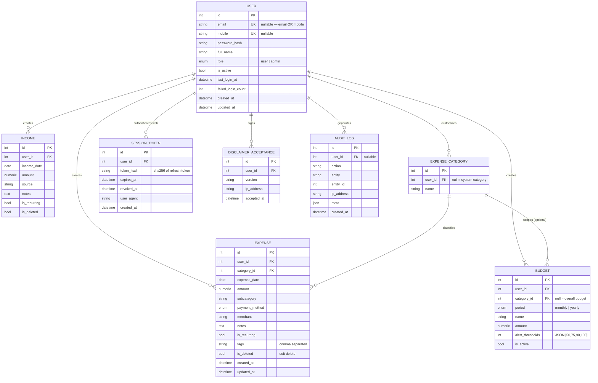

# 03 — Database Design (Phase 1)

## ER diagram

## Design decisions

- **Identity**: `email` and `mobile` are both unique but nullable — the product
  allows signing up with either. At least one is required (validated at the
  service layer).
- **Money**: `Numeric(14, 2)` — never floats. Currency is INR app-wide.
- **Soft deletion** (`is_deleted`) on user financial rows: analytics history
  must survive corrections, and accidental deletion must be recoverable.
- **System vs custom categories**: `expense_category.user_id IS NULL` marks
  system defaults visible to everyone; users add their own rows. Deletion of a
  system category is rejected; deletion of a category in use is rejected.
- **Refresh tokens stored as hashes**: a database leak must not yield usable
  credentials. Tokens are sha256-hashed with their server-side secret salt.
- **Audit log** is append-only and covers auth events and admin actions.

## Indexes

| Table | Index | Reason |
|---|---|---|
| expense | `(user_id, expense_date)` | every analytics query filters by user + range |
| expense | `(user_id, category_id)` | category distribution |
| income | `(user_id, income_date)` | income aggregation |
| budget | `(user_id, is_active)` | budget status lookups |
| session_token | `token_hash` (unique) | refresh lookup |
| audit_log | `(user_id, created_at)` | user timeline |
| audit_log | `action` | admin security views |

## Phase 2–4 extensions (planned, not created yet)

`stock`, `company`, `financial_statement`, `market_price`, `news_article`,
`sentiment_analysis`, `valuation`, `valuation_scenario`, `portfolio`,
`portfolio_holding`, `portfolio_analysis`, `stock_analysis`, `report`,
`notification`, `api_usage`. The ER above is drawn so these attach without
reshaping Phase 1 tables.
